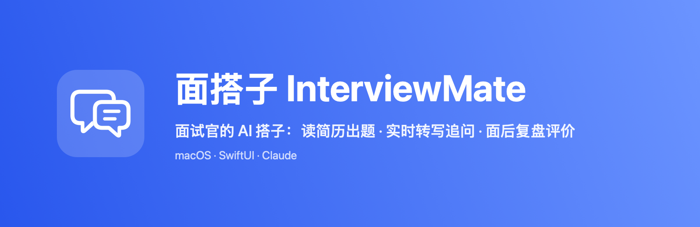
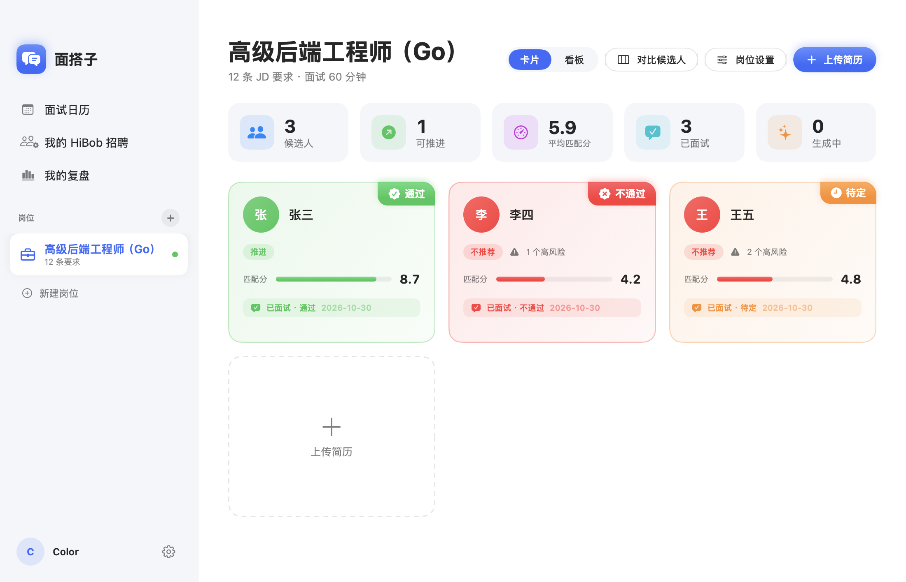
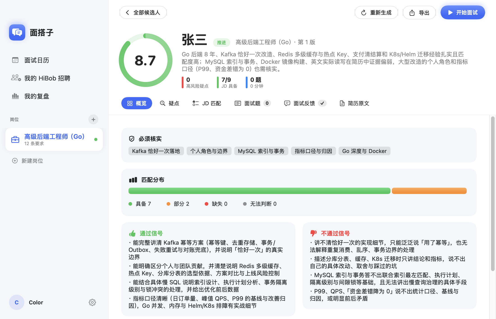
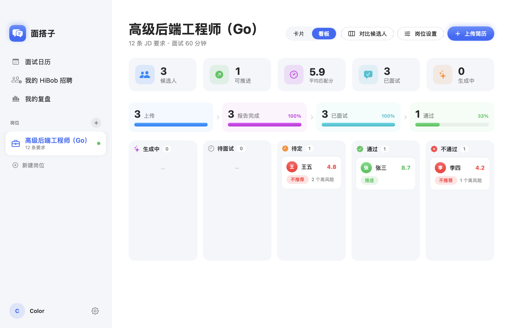
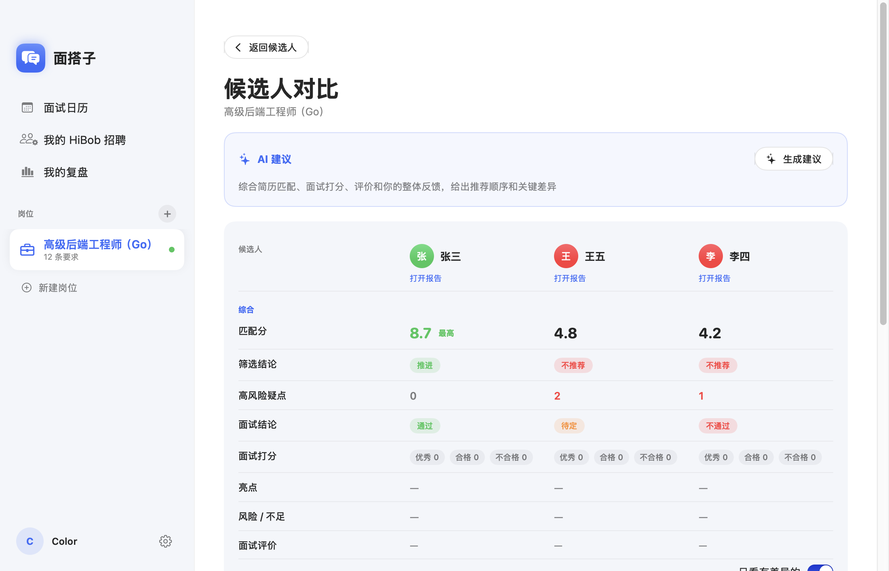

<p align="center"></p>

# 面搭子 InterviewMate

<p align="center">   </p>

面试官的 macOS 助手：从读简历、准备面试，到面试中实时提示、面试后出评价，全流程用 Claude 辅助。

输入一份 JD 和一份简历，生成一面准备材料（筛选结论、简历疑点、JD 匹配度、面试题、参考答案、评分标准）；面试时本机实时转写、提示追问；面试后逐题复盘、生成可直接贴进招聘系统的评价。

> AI 生成的内容需要面试官复核，是否推进由面试官决定。出生日期只用于时间线校验，年龄、性别、婚育、籍贯不参与评分和出题。

## 截图

截图使用虚构的演示数据（张三、李四、王五）。

| 候选人列表 | 筛选报告 |
|---|---|
|  |  |
| **岗位看板** | **候选人对比** |
|  |  |

## 功能

**面试前**
- **简历解析**：PDF / Word / Markdown，自动去除招聘平台水印，手机号和邮箱脱敏后再交给模型。
- **筛选报告**：JD 拆成可逐条匹配的要求，带权重；每条匹配都有简历原文证据，点击可在原文中高亮定位；匹配分、一票否决和结论由代码计算，保证同样的输入结论一致。
- **简历疑点**：规则引擎（年限矛盾、空窗、重叠、跳槽、内容重复等）加上 AI 语义疑点，每条附核实问题。
- **面试题**：按背景核实、项目深挖、核心能力、缺口场景、软性要求分环节出题，含参考答案要点、追问、红旗信号、评分标准，并按面试时长自动裁剪。题目涉及的简历段落会截图并标出。
- **简历原文 / 解析结果**：原样渲染 PDF，并提供结构化的工作、教育、项目表格。
- **多轮面试**：一面里仍存疑、没问到、答得不好的地方，自动带进二面重新出题。
- **导出**：Word、Markdown、单文件 HTML（可直接打印成 PDF）、不含答案的面试记录表。

**面试中**
- **面试模式**：逐题计时、打分（优秀 / 合格 / 不合格 / 跳过）、记备注，快捷键操作。
- **本机实时转写**：macOS 离线语音识别，麦克风算「我」，只监听会议软件（腾讯会议、飞书 / Lark、Zoom、Teams、钉钉、浏览器等）的声音算「候选人」。音频不离开本机、不保存。
- **实时追问提示**：根据这道题的逐字稿，提示还没答到的要点和下一句可以问的话，以及红旗信号。
- **一键标记**：⌘G 标记亮点、⌘D 标记存疑，总结时重点看。
- **时间把控**：剩余时间不够时提示建议跳过哪些题。

**面试后**
- **面试总结**：逐题复盘（答到 / 漏掉的要点、踩中的红旗、建议打分）、疑点核实结果、亮点和不足、口语化评价。
- **备注自动补全**：某题备注留空时，切题时 AI 根据逐字稿自动写一条。
- **候选人对比**：同一岗位 2～4 人并排比较，AI 给出推荐顺序和关键差异。
- **岗位看板**：漏斗统计，拖动卡片直接改面试结论。
- **发到 Lark 群**：评价以卡片形式发到群自定义机器人。
- **我的复盘**：打分分布、和 AI 建议相比偏宽还是偏严、各环节跳过率。

**日程和招聘系统**
- **面试日历**：读取 Mac「日历」（可在 系统设置 › 互联网账户 加 Google 账号）或 Google 日历 iCal 私密地址，按候选人姓名自动绑定，开始前 N 分钟提醒。支持列表、日、周、月视图，识别多种会议软件的链接和会议号。
- **HiBob**：用个人 Bob 账号通过 [Bob 官方 MCP](https://apidocs.hibob.com/docs/hibob-mcp-server) 登录（OAuth + PKCE），拉取你能看到的在招岗位和应聘人、所处阶段；也支持 Service User 方式。HiBob 不开放写入，反馈提供按格式复制。
- **简历自动导入**：「下载」文件夹出现新简历时，提示导入到哪个岗位。

**其他**
- 中英文界面；AI 输出语言、语音转写语言可选。
- 打分系数、结论分数线、默认权重、数据保留天数等都可在设置里改。
- 数据只存在本机 `data/`，超过保留期（默认 180 天）自动删除。

## 安装和运行

需要 macOS 15+、Xcode 命令行工具（Swift 6）、[uv](https://docs.astral.sh/uv/)、Claude API Key。

```bash
git clone https://github.com/almightyYantao/InterviewMate.git
cd InterviewMate
uv sync

# 打包 macOS App：生成 ~/Applications/面搭子.app
cd macos && ./build-app.sh
open ~/Applications/面搭子.app
```

App 启动时会在后台拉起 Python 服务（`uv run uvicorn screener.web:app`），工程目录在打包时写进 App，所以打包后不要移动项目目录。

首次使用：
1. **设置 › AI 接口**：填 Anthropic API Key（或者用环境变量 `ANTHROPIC_API_KEY` / `ant` 命令行的默认配置），可以填接口地址和模型。
2. **语音转写**：系统设置 › 键盘 › 听写，打开并下载对应语言；首次转写时允许麦克风、语音识别、系统录音权限。
3. **签名（可选）**：在 `macos/.sign-identity` 里写入你的开发者证书名或 SHA-1，重新打包后系统权限不会失效；不写就用临时签名。

也可以不打包 App，直接用命令行或网页：

```bash
uv run python -m screener.cli --jd fixtures/input/jd_network_engineer.md --resume 简历.pdf -o out/demo
uv run uvicorn screener.web:app --port 8000   # 简易网页版
uv run pytest -q                              # 单元测试，不调模型
```

## 代码结构

| 路径 | 说明 |
|---|---|
| `screener/parsing.py` | 简历解析、水印过滤、脱敏 |
| `screener/rules.py` / `scoring.py` / `verify.py` | 规则引擎、打分和结论、证据校验、题目覆盖和时长 |
| `screener/pipeline.py` | 报告生成编排（JD 结构化 → 简历结构化 → 规则 → 匹配 + 疑点 → 出题 → 结论 → 校验） |
| `screener/evaluation.py` | 面试评价、逐题复盘、单题备注、实时提示、候选人对比 |
| `screener/llm.py` / `prompts/` | Claude 调用（structured outputs + 流式）和各阶段 prompt |
| `screener/snippet.py` | 简历 PDF 截图、行定位、整页渲染 |
| `screener/calendar_ics.py` | 日历日程解析、会议识别、候选人匹配 |
| `screener/hibob_mcp.py` / `hibob.py` | HiBob 个人账号（MCP）和 Service User 对接 |
| `screener/lark.py` | Lark 群机器人卡片 |
| `screener/render.py` / `render_html.py` | Word / Markdown / HTML 导出 |
| `screener/store.py` / `config.py` / `web.py` | SQLite 存储、设置、HTTP 接口 |
| `macos/` | SwiftUI App：界面、转写（`Transcriber.swift`、`ProcessTap.swift`）、日历提醒、打包脚本、图标和英文词表 |

模型默认：Claude Sonnet 5.5（快速：结构化、匹配、评价、实时提示）、Claude Opus 5.5（强：疑点、出题、面试总结），可在设置里改。

## 隐私

- 简历、报告、打分、逐字稿、API Key 和登录令牌都只存在本机 `data/`（已在 `.gitignore`），不会进仓库。
- 发给模型前，手机号、邮箱、身份证号会替换成占位符。
- 录音前会提示征得候选人同意；音频只在本机识别，不保存。
